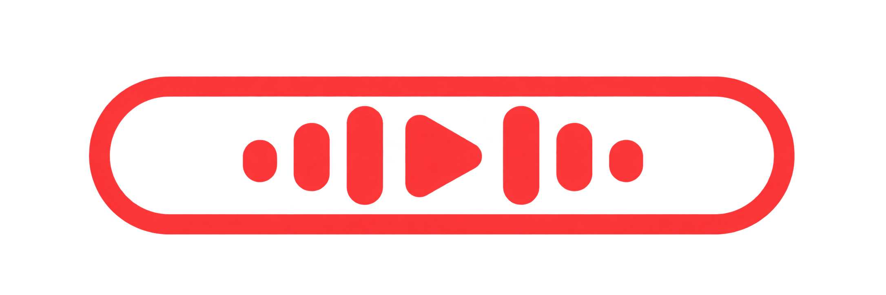

<p align="center">
  
</p>

<h1 align="center">Touchtrack</h1>
<p align="center"><strong>Give your Touch Bar something worth playing.</strong></p>
<p align="center">YouTube Music with native Touch Bar controls and karaoke lyrics, right on your keyboard.</p>

<p align="center">
  <a href="https://github.com/alifnrhman/touchtrack/actions/workflows/ci.yml"></a>
  
  
  
  
</p>

Skip a track, pause the music, or follow the lyrics without switching windows. Touchtrack brings YouTube Music to a desktop app and puts the controls on your MacBook's Touch Bar.

## What you get

- **Music at your fingertips.** Play/pause, previous, next, artwork, and seek controls.
- **Lyrics on your keyboard.** Follow the current and next lines, with a smooth karaoke highlight when word timing is available.
- **Keep listening while you work.** Music plays in the background. An optional experimental mode keeps the Touch Bar controls visible in other apps.
- **Built-in ad blocking.** Filters ad images and attempts to skip video ads. Toggle it from the app menu.
- **No extra tools.** No browser extension or BetterTouchTool required.

## Install

**Requirements:** macOS 14 or later. You'll need a MacBook with a Touch Bar to use the hardware controls. Tested on Apple Silicon; Intel builds are not yet verified.

A public download has not been published yet. Once an installer is available:

1. Open the Touchtrack `.dmg`.
2. Drag **Touchtrack** into **Applications**.
3. Open Touchtrack and choose a song.

Current builds are unsigned and unnotarized, so macOS may block launch. Developers can [build from source](#development).

## Make it yours

Browse YouTube Music as usual, or choose **Touchtrack → Sign In…** to access your account. Sign in inside Touchtrack once; it does not reuse your Chrome session.

| Action | Where to find it |
| --- | --- |
| Play/pause, skip, or seek | Touch Bar |
| Switch between lyrics and track details | Speech-bubble button or **⌘L** |
| Reload the player | **⌘R** |
| Turn ad blocking on/off | **Touchtrack → Block Ads** |
| Show controls while using other apps | **♫ → Keep Touch Bar Visible (Experimental)** |
| Return to normal Touch Bar behavior | **♫ → Restore Normal Touch Bar** |

Keep the app running for background playback. After installing an update, fully quit and reopen it.

## A few things to know

Touchtrack is experimental. Signed-in playback and session persistence across an app restart have worked on the test Mac, but Google may restrict embedded sign-in. Intel, clean-machine installation, and broader Touch Bar hardware compatibility still need testing.

Lyrics depend on the song and provider; some tracks have line timing only or no lyrics. Ad blocking does not catch every ad. If playback stalls, try reloading or turning **Block Ads** off. The optional global Touch Bar mode uses private macOS APIs and may break after an OS update.

## Privacy and credits

Lyrics come from [Better Lyrics](https://betterlyrics.org/) with [LRCLIB](https://lrclib.net/docs) as a fallback. To find lyrics, Touchtrack sends the song title, artist, album, and duration to Better Lyrics; the fallback sends title, artist, and duration to LRCLIB. These requests do not include Google cookies or credentials. Lyrics are cached in memory, not saved to disk. Turn lyrics mode off to stop new requests and cancel pending ones.

Touchtrack is an independent project, not affiliated with YouTube, Google, or Apple.

---

## Development

Built with **Tauri v2, Rust, TypeScript, and Swift/AppKit**. YouTube Music runs in a WKWebView; a TypeScript adapter passes playback state through Rust to the native Touch Bar controller. Swift handles lyrics and rendering, with a small Objective-C bridge for experimental global visibility.

### Run from source

Install Node.js/npm, stable Rust, and Apple Command Line Tools with the Swift compiler. From the repository directory:

```sh
npm ci
npm run tauri dev
```

### Build

```sh
npm run app  # macOS application
npm run dmg  # application + DMG installer
```

Output: `src-tauri/target/release/bundle/`. Builds target the host architecture. To build for Intel (unverified):

```sh
rustup target add x86_64-apple-darwin
npm run tauri build -- --target x86_64-apple-darwin --bundles app,dmg
```

### Checks

```sh
npm test
cargo test --manifest-path src-tauri/Cargo.toml --release
npm run test:lyrics
npm run test:adblock
npm run test:global
```

Run `npm test` before Cargo tests so the embedded frontend artifacts exist. Native checks require macOS; fixture tests do not replace physical Touch Bar testing.

GitHub Actions runs these checks and packages the macOS app on pushes to `main` and pull requests. CI does not test Google sign-in, live ad removal, or physical Touch Bar interaction.

### Read more

[Architecture](docs/architecture.md) · [Lyrics](docs/lyrics.md) · [Ad blocker](docs/adblock.md) · [Global Touch Bar](docs/global-touchbar.md) · [Build and release status](docs/release.md) · [Contributing](CONTRIBUTING.md)

## License

[MIT](LICENSE). Dependencies retain their own licenses. YouTube content, lyrics, and third-party trademarks are not covered by this project's license.
